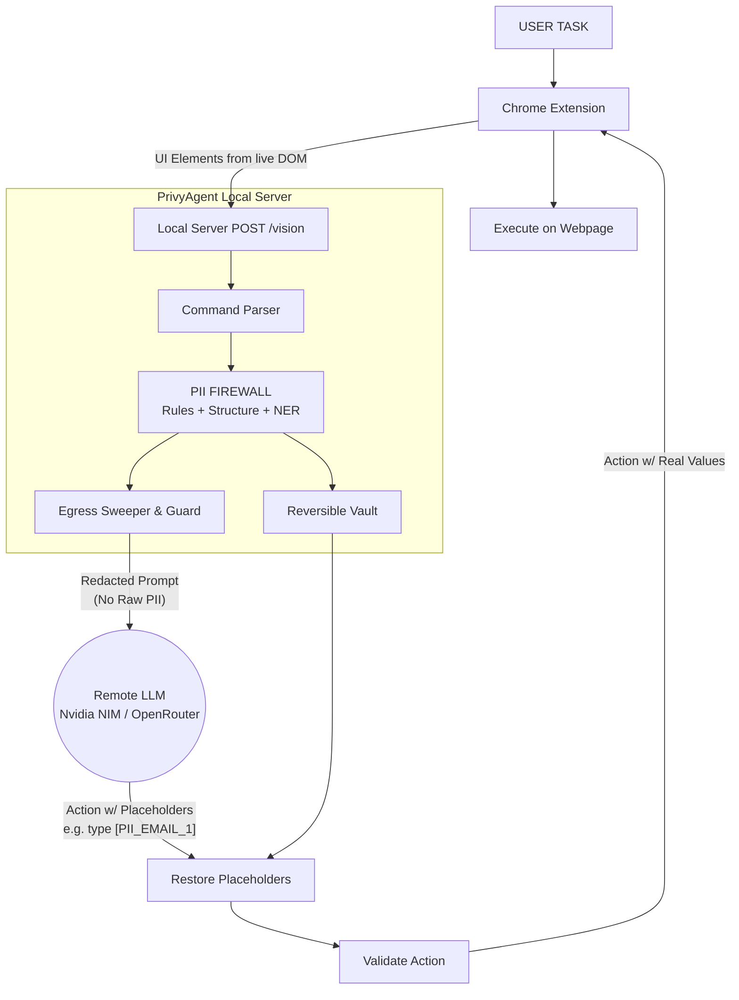

# PrivyAgent — On-Device Privacy-First Browser Agent

PrivyAgent is a lightweight, privacy-preserving browser automation agent. It executes multi-step natural language tasks on the web without ever sending raw personally identifiable information (PII) to remote LLMs.

## 🚀 Key Features

* **100% On-Device Privacy Firewall**: Uses rules, DOM structure analysis, and a local ONNX MiniLM NER model to redact PII (emails, names, phones, cards, passwords) *before* it leaves your machine.
* **Reversible Vault**: PII is replaced with opaque placeholders (e.g., `[PII_EMAIL_1]`) for the LLM to reason about. When the LLM outputs a typing action, the real value is restored locally just before execution in the browser.
* **Proactive Egress Guard**: Every outgoing LLM payload is strictly checked against the Vault. A "sweeper" catches any straggling Vault substrings and scrubs them to `[EGRESS_REDACTED]` to mechanically guarantee zero PII leakage.
* **Structured Action Execution**: The LLM outputs strict JSON commands (`click`, `type`, `select`, `scroll`) tied to active DOM element IDs. No arbitrary JavaScript (`eval`) is ever executed.
* **Multi-Turn Agent Loop**: Seamlessly executes sequential tasks (e.g., "type my name, enter my email, and click submit") across multiple interactions.
* **Nvidia NIM & OpenRouter Integration**: Uses ultra-fast models like `mistralai/mistral-nemotron` (via Nvidia NIM) with automatic failover to OpenRouter if NIM is unavailable.
* **Offline Local Planner**: Built-in deterministic fallback for basic tasks when APIs are offline or disconnected.

---

## 🏗️ Architecture



The strict privacy boundary is the network call to the LLM. Everything else runs locally on your machine.

---

## 🛠️ Setup Instructions

### 1. Start the Python Server
The Python backend manages orchestration, privacy redaction, and LLM communication.

```bash
# Navigate to the repository
cd privyagent

# Install dependencies
pip install fastapi uvicorn pydantic openai requests beautifulsoup4

# Start the server (runs on http://127.0.0.1:8000)
python -m uvicorn server.main:app --host 127.0.0.1 --port 8000
```

### 2. Build the Chrome Extension
The extension extracts DOM elements and safely executes the LLM's commands.

```bash
cd extension
npm install
npm run build
```

### 3. Load the Extension into Chrome
1. Open Chrome and navigate to `chrome://extensions/`
2. Enable **Developer mode** (top right corner)
3. Click **Load unpacked**
4. Select the `privyagent/extension/dist` folder.
5. Pin the extension to your toolbar, open the popup, and start giving commands!

---

## ⚙️ Configuration (.env)

Create a `.env` file in the root of the project to configure your API keys and models:

```env
# Primary LLM API Key (Nvidia NIM)
NVIDIA_API_KEY=nvapi-your-key-here

# Fallback API Key (OpenRouter)
OPENROUTER_API_KEY=sk-or-your-key-here

# Preferred Model (Default: mistralai/mistral-nemotron)
PRIVYAGENT_MODEL=mistralai/mistral-nemotron

# Backend choice: 'openrouter' (LLM) or 'local' (offline deterministic planner)
PRIVYAGENT_LLM=openrouter
```

The system will prioritize Nvidia NIM if `NVIDIA_API_KEY` is present. If it encounters API errors (e.g., 404, Authentication), it will automatically failover to OpenRouter.

---

## 🔒 Security & Privacy Guarantees

1. **No remote execution of arbitrary code**: The LLM cannot output JavaScript. The Chrome extension parses only rigid JSON formats and validates `element_id` against the live DOM capture before any interaction.
2. **Egress Guarantee**: The `assert_clean` and `sweep_payload` pipeline ensures that it is mechanically impossible for a detected Vault secret to cross the network boundary, regardless of upstream LLM formatting.
3. **Screenshots are local-only**: Visual screenshots are captured by the extension but are explicitly dropped by the server before any LLM calls are made, as pixel-level redaction is not yet implemented.
4. **Local Loopback Only**: The FastAPI server binds strictly to `127.0.0.1` and enforces CORS specifically for the Chrome Extension origin.

---

## 🧪 Testing

The backend is fully tested for privacy leakage, parsing, LLM fallbacks, and orchestration looping.

```bash
# Run the integration tests
python test_full_backend.py
```
*(All 32 tests currently pass, verifying Vault restoration, Egress blocking, and End-to-End Orchestration).*
